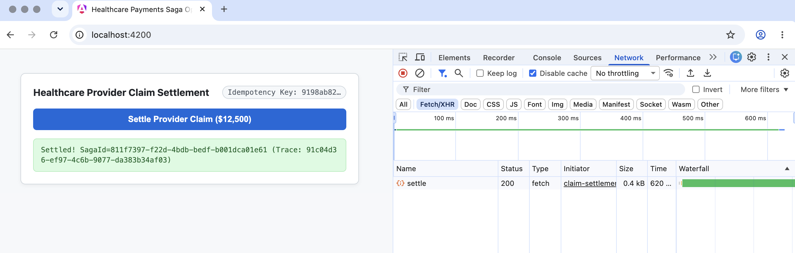

# Healthcare Payments Saga & Non-Blocking Ingestion Template

A production-grade financial engineering reference architecture and GitHub Repository Template built with **.NET 10 (C#)**, **T-SQL**, and **Angular**. 

This repository demonstrates two core pillars required for high-throughput financial and healthcare payment systems:
1. **Resilient Distributed Transactions & Low-Latency I/O:** Replacing brittle Two-Phase Commit (2PC) distributed locks with **Saga Orchestration + Transactional Outbox**, paired with zero-allocation `System.IO.Pipelines` → `System.Threading.Channels` ingestion.
2. **Engineering Governance & Guardrails-as-Code:** Enforcing bank-ready standards at the template level via `AGENTS.md` (for OpenCode/Copilot), dual-control `.github/CODEOWNERS` reviews, and mandatory CI/CD concurrency and zero-allocation SLA gates.

---

## Repository Structure

```text
├── .github/
│   ├── CODEOWNERS                  # Dual-control approval rules for SQL, Guardrails & CI/CD
│   └── workflows/
│       └── ci-cd.yml               # Blocks PRs/merges unless -warnaserror & xUnit gates pass
├── docs/
│   ├── ARCHITECTURE.md             # Deep dive: 2PC vs. Saga/Outbox & Pipelines backpressure
│   └── images/saga-idempotency-demo.png # Split-screen UI + DevTools Network proof of idempotency.
├── frontend/src/app/
│   └── claim-settlement.component.ts # Angular standalone UI with exhaustMap double-click guard
├── sql/
│   └── 001_init_ledger_and_outbox.sql # Atomic balance reservation + Transactional Outbox DDL/SP
├── src/Payments.Api/
│   ├── Guardrails/
│   │   └── PaymentComplianceGuardrail.cs # Deterministic policy & NPI invariants
│   ├── Pipelines/
│   │   └── ClaimStreamIngestor.cs        # Zero-alloc Pipelines + Hybrid SequenceReader
│   ├── Sagas/
│   │   └── ClaimPaymentSagaOrchestrator.cs # Saga coordinator + compensating refunds
│   └── Program.cs                        # Minimal API + Bounded Channel background worker
├── tests/Payments.Tests/
│   └── PaymentSagaAndPipelineTests.cs    # Race-condition, compensation & GC memory SLA tests
└── AGENTS.md                             # AI coding assistant constraints (OpenCode / Copilot)
```

---

## Key Architectural Highlights

* **Zero-Allocation Batch Ingestion (`ClaimStreamIngestor.cs`):** Streams raw NDJSON claim batches via `System.IO.Pipelines` with explicit high/low watermarks (`64 KB` / `32 KB`), hybrid `ReadOnlySpan<byte>` / `SequenceReader<byte>` framing, `Utf8JsonReader` parsing (zero intermediate heap strings), poison-frame quarantine, and bounded `Channel<T>` backpressure.
* **Saga Orchestration & Transactional Outbox (`ClaimPaymentSagaOrchestrator.cs` & `001_init_ledger_and_outbox.sql`):**
  * Avoids cross-service 2PC locks by committing a **semantic lock** (`AvailableBalance` $\rightarrow$ `ReservedBalance`) and writing the `ClaimFundsReserved.v1` event to `dbo.OutboxMessages` inside a single local ACID transaction.
  * Uses client-generated `ClaimId` idempotency keys for safe network retries.
  * Automatically executes `CompensateReservationAsync` to restore payer liquidity if compliance guardrails or external ACH clearinghouse settlement fail.
* **Deterministic AI & Policy Guardrails (`PaymentComplianceGuardrail.cs`):** Enforces strict financial ceilings (`$250,000` automated limit) and 10-digit NPI validation before funds move, tested against a `0-byte` managed heap allocation SLA (`GC.GetTotalMemory`).
* **Frontend Idempotency (`claim-settlement.component.ts`):** Uses RxJS `exhaustMap` and Angular Signals to drop duplicate clicks while a Saga is in flight, rotating a client-side UUID `claimId` upon settlement.

---

## Proof of Idempotency & Double-Click Guard



The left side shows the settled Angular `ClaimSettlementComponent`: the success banner with the returned **SagaId** and **Trace**, plus the **Idempotency Key** badge displaying the rotated key (first 8 characters of the new `claimId`). The right side shows Chrome DevTools **Network (Fetch/XHR)** during rapid clicking — exactly **one** `POST /api/claims/settle` request is issued, because RxJS `exhaustMap` drops every click that arrives while the settlement is in flight. A second request only appears after the key rotates on `200 OK`; a `409 Conflict` leaves the key untouched so retries stay idempotent.

---

## Quick Start & Quality Gates

### Prerequisites
* [.NET 10 SDK](https://microsoft.com)
* GitHub CLI (`gh`) and [OpenCode](https://opencode.ai) (optional, for AI-assisted feature scaffolding)

### Build & Run Quality Gates Locally
```bash
# 1. Restore and compile with warnings treated as errors
dotnet build HealthcarePayments.sln --configuration Release -warnaserror

# 2. Run concurrency, Saga compensation, Pipeline, and GC allocation tests
dotnet test HealthcarePayments.sln --configuration Release --no-build --verbosity normal

# 3. Run the Minimal API locally
dotnet run --project src/Payments.Api/Payments.Api.csproj
```

---

## Using This Repository as a Team Template

Engineers can scaffold a new compliant microservice inheriting `AGENTS.md`, `CODEOWNERS`, OpenTelemetry `ActivitySource` tracing, and CI quality gates from Day 1:

```bash
gh repo create <org>/<new-service-name> \
  --template jmwuerth/healthcare-payments-saga-ops \
  --private \
  --clone
```
