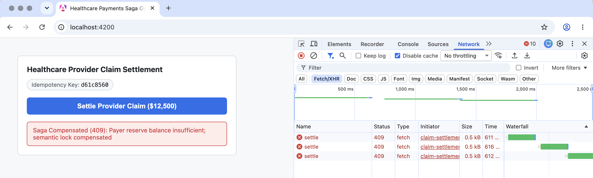

# Healthcare Payments Saga & Non-Blocking Ingestion Template

A production-grade financial engineering reference architecture and GitHub Repository Template built with **.NET 10 (C#)**, **T-SQL**, and **Angular**. 

This repository demonstrates two core pillars required for high-throughput financial and healthcare payment systems:
1. **Resilient Distributed Transactions & Low-Latency I/O:** Replacing brittle Two-Phase Commit (2PC) distributed locks with **Saga Orchestration + Transactional Outbox**, paired with zero-allocation `System.IO.Pipelines` → `System.Threading.Channels` ingestion.
2. **Engineering Governance & Guardrails-as-Code:** Enforcing bank-ready standards at the template level via `AGENTS.md` (for OpenCode/Copilot), dual-control `.github/CODEOWNERS` reviews, and mandatory CI/CD concurrency and zero-allocation SLA gates.

---

## Repository Structure

```text
├── .github/
│   ├── CODEOWNERS                  # Dual-control approval rules for SQL, Guardrails & CI/CD
│   └── workflows/
│       └── ci-cd.yml               # Blocks PRs/merges unless .NET, xUnit & Angular AOT gates pass
├── docs/
│   ├── ARCHITECTURE.md             # Deep dive: 2PC vs. Saga/Outbox & Pipelines backpressure
│   ├── images/saga-idempotency-demo.png # Split-screen UI + DevTools Network proof of idempotency.
│   └── images/saga-compensation-409-demo.png # 409 Conflict proof: automatic compensation + preserved key.
├── frontend/
│   ├── mock-api.mjs                  # Cross-platform Node mock API (200 OK / 409 Conflict)
│   ├── package.json                  # Angular 20 workspace + concurrently scripts
│   ├── proxy.conf.json               # Forwards /api to http://localhost:3000
│   └── src/
│       ├── index.html                # Mounts <app-claim-settlement>
│       ├── main.ts                   # Bootstrap with provideHttpClient()
│       └── app/
│           └── claim-settlement.component.ts # Angular standalone UI with exhaustMap double-click guard
├── sql/
│   └── 001_init_ledger_and_outbox.sql # Atomic balance reservation + Transactional Outbox DDL/SP
├── src/Payments.Api/
│   ├── Guardrails/
│   │   └── PaymentComplianceGuardrail.cs # Deterministic policy & NPI invariants
│   ├── Pipelines/
│   │   └── ClaimStreamIngestor.cs        # Zero-alloc Pipelines + Hybrid SequenceReader
│   ├── Sagas/
│   │   └── ClaimPaymentSagaOrchestrator.cs # Saga coordinator + compensating refunds
│   └── Program.cs                        # Minimal API + Bounded Channel background worker
├── tests/Payments.Tests/
│   └── PaymentSagaAndPipelineTests.cs    # Race-condition, compensation & GC memory SLA tests
└── AGENTS.md                             # AI coding assistant constraints (OpenCode / Copilot)
```

---

## Key Architectural Highlights

* **Zero-Allocation Batch Ingestion (`ClaimStreamIngestor.cs`):** Streams raw NDJSON claim batches via `System.IO.Pipelines` with explicit high/low watermarks (`64 KB` / `32 KB`), hybrid `ReadOnlySpan<byte>` / `SequenceReader<byte>` framing, `Utf8JsonReader` parsing (zero intermediate heap strings), poison-frame quarantine, and bounded `Channel<T>` backpressure.
* **Saga Orchestration & Transactional Outbox (`ClaimPaymentSagaOrchestrator.cs` & `001_init_ledger_and_outbox.sql`):**
  * Avoids cross-service 2PC locks by committing a **semantic lock** (`AvailableBalance` $\rightarrow$ `ReservedBalance`) and writing the `ClaimFundsReserved.v1` event to `dbo.OutboxMessages` inside a single local ACID transaction.
  * Uses client-generated `ClaimId` idempotency keys for safe network retries.
  * Automatically executes `CompensateReservationAsync` to restore payer liquidity if compliance guardrails or external ACH clearinghouse settlement fail.
* **Deterministic AI & Policy Guardrails (`PaymentComplianceGuardrail.cs`):** Enforces strict financial ceilings (`$250,000` automated limit) and 10-digit NPI validation before funds move, tested against a `0-byte` managed heap allocation SLA (`GC.GetTotalMemory`).
* **Frontend Idempotency (`claim-settlement.component.ts`):** Uses RxJS `exhaustMap` and Angular Signals to drop duplicate clicks while a Saga is in flight, rotating a client-side UUID `claimId` upon settlement.

> **Reference Template Boundary:** To keep `Payments.Api` 100% .NET 10 Base Class Library (BCL-only) with zero external NuGet dependencies out of the box, the runnable API uses an in-memory ledger and clearinghouse simulator alongside reference T-SQL DDL (`sql/001_init_ledger_and_outbox.sql`). See [Section 4 of `docs/ARCHITECTURE.md`](docs/ARCHITECTURE.md#4-template-scope-vs-production-hardening-roadmap) and [[`docs/ROADMAP.md`](docs/ROADMAP.md)]([docs/ROADMAP.md](docs/ROADMAP.md)) for the production hardening roadmap (Outbox Relay worker with `UPDLOCK/READPAST` leasing, state-aware replay short-circuiting, poison-frame quarantine, and `Testcontainers.MsSql` / OpenTelemetry OTLP integration).

### Why Saga + Transactional Outbox Over Two-Phase Commit (2PC)?

2PC holds distributed locks across every participant until the slowest one votes, so a single stalled ACH or ledger call freezes payer balances service-wide. This template keeps all locking local and makes the event publication atomic with the state change. See [`docs/ARCHITECTURE.md`](docs/ARCHITECTURE.md) for the sequence diagrams and `System.IO.Pipelines` backpressure internals.

| Concern | Two-Phase Commit (2PC / MSDTC) | Saga Orchestration + Outbox (This Template) |
| --- | --- | --- |
| **Locking & Contention** | Enlists every resource manager; locks are held network-wide until the coordinator commits or aborts, so one slow participant blocks unrelated claims. | Single local T-SQL transaction applying the semantic lock `AvailableBalance` → `ReservedBalance`; no lock survives the commit. |
| **Event Atomicity** | No guarantee that the commit and the downstream event publish both succeed; a crash between them silently loses the event. | `ClaimFundsReserved.v1` is written to `dbo.OutboxMessages` in the **same** local ACID transaction as the balance mutation. |
| **Failure & Rollback** | Abort requires every participant to be reachable and to honor the prepared vote; heuristic outcomes leave balances stranded. | `CompensateReservationAsync` restores reserved funds on any post-reservation failure and returns `409 Conflict` with liquidity fully restored. |
| **Retry Safety** | Retry semantics are coordinator-defined; duplicate commits after a timeout are a real double-charge risk. | Client-generated `ClaimId` idempotency keys make replays safe, and the Angular `exhaustMap` guard suppresses duplicate in-flight clicks. |

---

## Proof of Idempotency & Double-Click Guard




The left side shows the settled Angular `ClaimSettlementComponent`: the success banner with the returned **SagaId** and **Trace**, plus the **Idempotency Key** badge displaying the rotated key (first 8 characters of the new `claimId`). The right side shows Chrome DevTools **Network (Fetch/XHR)** during rapid clicking — exactly **one** `POST /api/claims/settle` request is issued, because RxJS `exhaustMap` drops every click that arrives while the settlement is in flight. A second request only appears after the key rotates on `200 OK`; a `409 Conflict` leaves the key untouched so retries stay idempotent.

The `409 Conflict` view demonstrates automatic **semantic-lock compensation**. When the clearinghouse rejects the ACH settlement (or a compliance guardrail fails), the orchestrator invokes `CompensateReservationAsync`, restoring the reserved amount to `AvailableBalance` and rendering the **semantic-lock compensation banner** with **Saga Compensated (409)** and the compensation reason. Unlike the `200 OK` settlement above — which rotates the **Idempotency Key** (`claimId`) so the next claim gets a fresh key — a compensated response keeps the **Idempotency Key** (`claimId`) **unchanged**. Every sequential operator retry therefore reuses the same idempotency key, so the server can recognize the retry, re-attempt reservation cleanly, and avoid double-paying or double-reserving funds.

---

## Quick Start & Quality Gates

### Prerequisites
* [.NET 10 SDK](https://microsoft.com)
- **Node.js** `^20.19.0`, `^22.12.0`, or `>=24.0.0` (Angular 20 workspace; verified locally on Node 22.12.0)
* GitHub CLI (`gh`) and [OpenCode](https://opencode.ai) (optional, for AI-assisted feature scaffolding)

### Build & Run Quality Gates Locally
```bash
# 1. Restore and compile with warnings treated as errors
dotnet build HealthcarePayments.sln --configuration Release -warnaserror

# 2. Run concurrency, Saga compensation, Pipeline, and GC allocation tests
dotnet test HealthcarePayments.sln --configuration Release --no-build --verbosity normal

# 3. Run the Minimal API locally
dotnet run --project src/Payments.Api/Payments.Api.csproj
```

---

## Using This Repository as a Team Template

Engineers can scaffold a new compliant microservice inheriting `AGENTS.md`, `CODEOWNERS`, OpenTelemetry `ActivitySource` tracing, and CI quality gates from Day 1:

```bash
gh repo create <org>/<new-service-name> \
  --template jmwuerth/healthcare-payments-saga-ops \
  --private \
  --clone
```

### Run the Angular Frontend with the Local Mock API

`frontend/` is a permanent, standalone Angular 20 workspace checked into this repository:

| Path | Purpose |
| --- | --- |
| `frontend/package.json` | Angular 20 dependencies plus `mock`, `start:mock`, and `start:mock:409` scripts (`concurrently`). |
| `frontend/proxy.conf.json` | Forwards `/api` to `http://localhost:3000` so requests are real HTTP traffic. |
| `frontend/mock-api.mjs` | Cross-platform Node mock server (built-in `node:http` / `node:crypto`, 600 ms latency). |
| `frontend/src/main.ts` | Bootstraps `ClaimSettlementComponent` with `provideHttpClient()`. |
| `frontend/src/index.html` | Mounts `<app-claim-settlement></app-claim-settlement>`. |

Start the mock API and the Angular dev server together:

```bash
cd frontend
npm install
npm run start:mock       # 200 OK mock on :3000 + ng serve with proxy.conf.json
npm run start:mock:409   # 409 Conflict mock on :3000 + ng serve with proxy.conf.json
```

Open the dev-server URL, then use **Chrome DevTools → Network (`Fetch/XHR`)** and rapidly click **Settle Provider Claim ($12,500)** 4–5 times. Only one `POST /api/claims/settle` should be in flight at a time, and the `Idempotency Key` rotates after `200 OK`.

The mock returns `200 OK` (`state: 2`) by default. To exercise the compensation UI, run `npm run start:mock:409` to launch both the `409 Conflict` mock server and Angular together. For the mock server alone, start it with `--409` or send the `X-Mock-Status: 409` header:

```bash
npm run mock -- --409    # every settlement returns 409 Conflict (state: 3 + failureReason)
```

Verify the workspace without starting a server:

```bash
cd frontend
npx ng build
```

#### Why keep a permanent mock workspace instead of the `/tmp` throwaway harness?

* **Zero-Friction Onboarding:** Anyone cloning the repo can run `npm run start:mock` in `frontend/` and immediately test `ClaimSettlementComponent` in the browser instead of manually running `ng new` and `cat << 'INNER'` shell scripts in `/tmp`.
* **Built-In `409 Conflict` & Failure Simulation:** In the real .NET API (`Program.cs`), `InMemoryPaymentLedgerStore` starts empty so every HTTP call returns `409 "Insufficient payer liquidity"`, and `SimulatedClearinghouseGateway` only rejects NPIs starting with `999`. Because `ClaimSettlementComponent` hardcodes `providerNpi: '1234567890'`, a permanent `mock-api.mjs` lets you easily toggle between `200 OK` (idempotency key rotation) and `409 Conflict` (semantic-lock compensation with key preservation) to test both UI states.
* **Real Chrome DevTools Network & Latency Inspection:** Unlike in-memory Angular mocks, `mock-api.mjs` + `proxy.conf.json` routes real HTTP `POST /api/claims/settle` traffic over `localhost` with configurable latency (600ms), proving RxJS `exhaustMap` drops duplicate clicks in the `Fetch/XHR` tab.
* **Faster CI & AOT Typechecking:** Now that `frontend/` is a real Angular workspace in the repo, GitHub Actions `ci-cd.yml` can run `npm ci && npx ng build` inside `frontend/` instead of scaffolding a brand-new Angular project in `/tmp/ci-angular` on every push.
