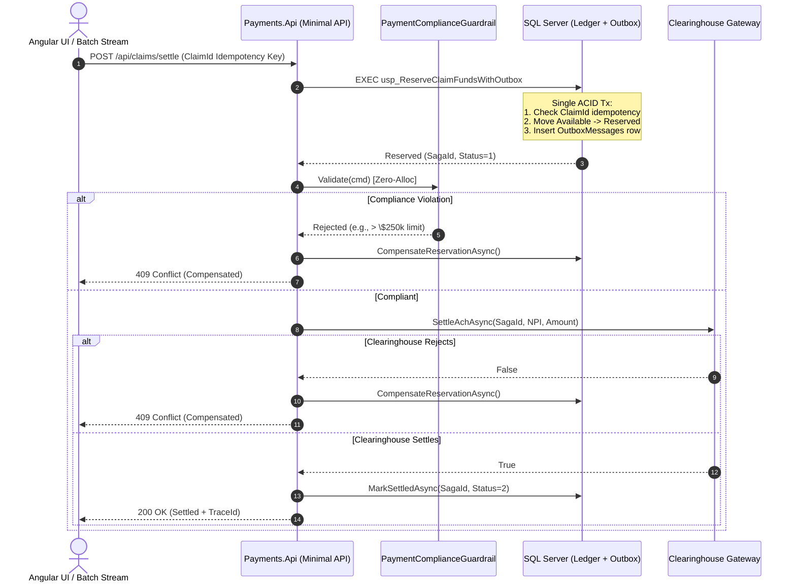
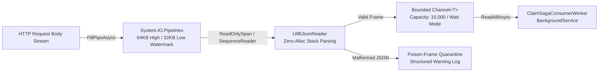

# System Architecture & Distributed Transaction Design

## 1. Why Saga + Transactional Outbox Over Two-Phase Commit (2PC)

In distributed financial architectures, Two-Phase Commit (2PC) couples service availability and holds physical database row/page locks across slow network calls:
* **In-Doubt Locks:** If a transaction coordinator crashes after Phase 1 (`Prepare`), SQL Server rows remain locked until manual recovery, halting concurrent settlements for that payer.
* **Availability Coupling:** Every participant (Ledger DB, Compliance Engine, External ACH Clearinghouse) must be online simultaneously.

### Our Solution: Semantic Locking + Local ACID Outbox
Instead of holding physical locks over HTTP, we split the write path into a sub-millisecond local ACID transaction followed by asynchronous orchestration with deterministic compensation:

---

## 2. Non-Blocking Ingestion Pipeline (`Pipelines` $\rightarrow$ `Channels`)

To ingest large batch claim files (NDJSON/EDI) without exhausting thread-pool threads or triggering Gen 2 Garbage Collection pauses:

1. **TCP-Level Backpressure:** `PipeOptions` pauses `FillPipeAsync` at `65,536` bytes and resumes at `32,768` bytes if downstream processing slows down.
2. **Zero-Allocation Parsing:** `TryReadLineHybrid` slices contiguous memory segments using `ReadOnlySpan<byte>` (falling back to `SequenceReader<byte>` across multi-segment boundaries), and `Utf8JsonReader` deserializes fields directly from UTF-8 bytes without allocating intermediate `string` payloads.
3. **Consumer Backpressure:** `Channel.CreateBounded<ClaimPaymentCommand>(10_000)` with `BoundedChannelFullMode.Wait` asynchronously suspends ingestion tasks rather than dropping messages or buffering unboundedly in RAM.

---

## 3. Dual-Control Engineering Governance

| Control Layer | Implementation | Purpose |
| :--- | :--- | :--- |
| **AI Guardrails** | `AGENTS.md` | Constrains OpenCode and Copilot to zero-allocation hot paths, Saga+Outbox patterns, and OpenTelemetry `ActivitySource` tracing. |
| **Segregation of Duties** | `.github/CODEOWNERS` | Requires `@jmwuerth` approval for changes to `/sql/`, `/Guardrails/`, `/AGENTS.md`, or `/.github/workflows/`. |
| **Automated CI Gates** | `.github/workflows/ci-cd.yml` | Enforces `dotnet build -warnaserror` and blocks PR merges if concurrency, compensation, or `0-byte` GC SLA tests fail. |

---

## 4. Template Scope vs. Production Hardening Roadmap

This repository is structured as a zero-dependency (.NET 10 BCL-only) reference template for local concurrency and memory-SLA testing.
* **Current Reference Implementation:** Uses BCL-only runtime (`Payments.Api`) with in-memory ledger/clearinghouse simulators, reference T-SQL DDL (`sql/001_init_ledger_and_outbox.sql`) for atomic fund reservations, and non-blocking `System.IO.Pipelines` ingestion.
* **Production Hardening Roadmap:** Details future enhancements including lease-based Outbox Relay workers (`UPDLOCK, READPAST`), state-aware replay short-circuiting, durable batch ingestion with poison-frame quarantine, and `Testcontainers.MsSql` / OpenTelemetry OTLP integration.